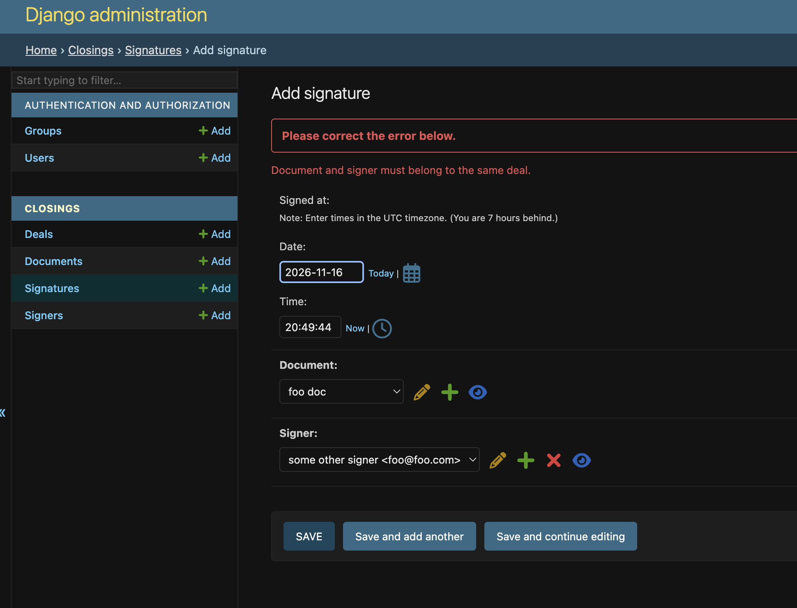
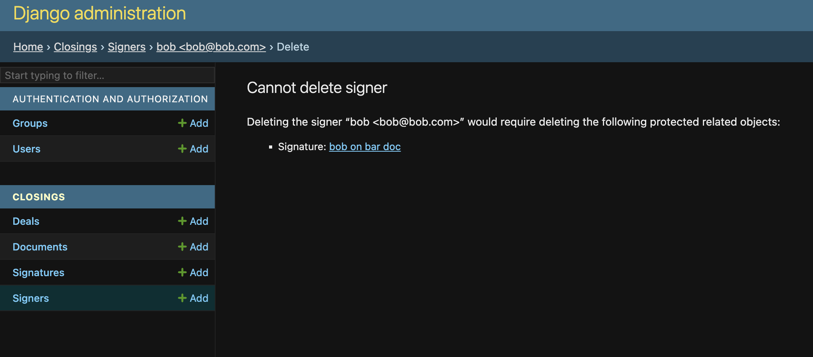

# Learning notes

What I tried, what happened, and why. Newest at the bottom.

## Models and the admin

### A signature can't pair a document and a signer from different deals

**Tried:** In the admin, created a second deal with its own signer, then added a
signature pairing that signer with a document from the first deal.

**Happened:** The form refused to save: "Document and signer must belong to the
same deal."

**Why:** `Signature.clean()` compares `document.deal_id` with `signer.deal_id` and
raises `ValidationError`. The admin calls `full_clean()` before saving, and
`full_clean()` calls `clean()`.

**Catch:** `save()` and `Signature.objects.create()` do not call `full_clean()`.
The rule only holds where something calls it, so the API needs to call it too or
repeat the check in the serializer. The database itself does not enforce this.

### Deleting a signer who has signed is blocked

**Tried:** Deleted a signer who already had a signature.

**Happened:** "Cannot delete signer", with the blocking signature listed.

**Why:** `Signature.signer` uses `on_delete=models.PROTECT`. With `CASCADE` the
delete would have removed the signature rows silently. `PROTECT` raises
`ProtectedError`, and the admin turns that into this page.

**Note:** `Signature.document` still cascades, so deleting a document or a deal
removes its signatures. Whether that is right depends on whether a signed
document should ever be deletable.

## Things that tripped me up

### `from models import ...` fails, `from .models import ...` works

`ModuleNotFoundError: No module named 'models'` on `makemigrations`. The leading
dot means "this package", like `./models` in TypeScript. Without it Python looks
for a top-level module. It broke `makemigrations` because Django imports every
app's `admin.py` at startup.

### `admin.register(...)` registered nothing

No error, but no models in the admin. `admin.register` is a decorator for a
`ModelAdmin` class, so calling it bare builds a decorator and discards it. The
direct call is `admin.site.register([...])`.

## Coming from Node

### No `await` in the request code

Standard Django is synchronous: each request runs on its own thread, so a
database call just blocks that thread until it returns. The request code is
simpler because it's synchronous, and the concurrency you have to think about
moves to the database (transactions and row locks) and the task queue (saya AI - Celery, that's next).
